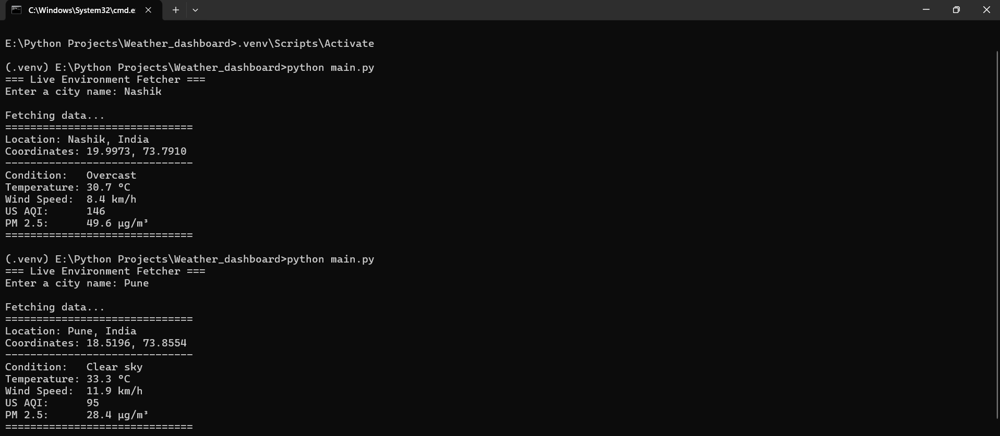
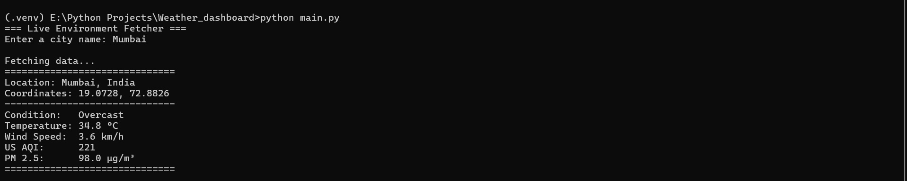

# Live Environment Dashboard

A Python command-line tool that uses the Open-Meteo API to fetch live weather conditions, temperature, and Air Quality Index (AQI) for any given city.

Built using `requests` and object-oriented and functional programming principles.

## Screenshots

### Screenshot 1


### Screenshot 2


## Tech Stack

- Python
- Requests
- Open-Meteo API

## Features

- Fetches live weather conditions for a given city.
- Retrieves temperature data.
- Fetches Air Quality Index (AQI) data.
- Uses API requests to retrieve current environmental information.
- Applies object-oriented and functional programming principles.

## Getting Started

### 1. Clone the repository

```bash
git clone https://github.com/paragpatil107/weather-dashboard.git
cd weather-dashboard
```

### 2. Install dependencies

```bash
pip install -r requirements.txt
```

### 3. Run the application

Run the Python entry-point script:

```bash
python main.py
```

## Project Structure

```text
weather-dashboard/
├── screenshots/
│   ├── 1.png
│   └── 2.png
├── main.py
├── requirements.txt
└── readme.md
```

## Data Source

Weather and environmental data are retrieved using the [Open-Meteo API](https://open-meteo.com/).

## Author

Parag Patil
